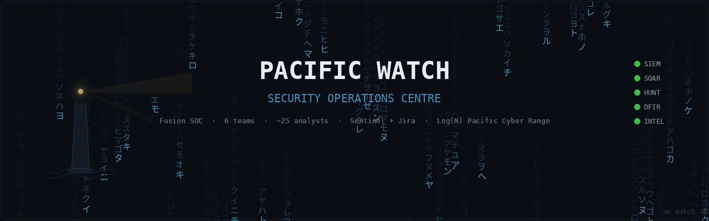
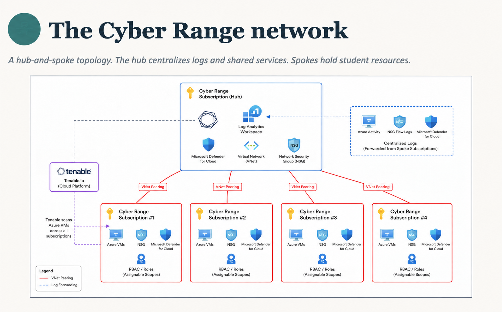
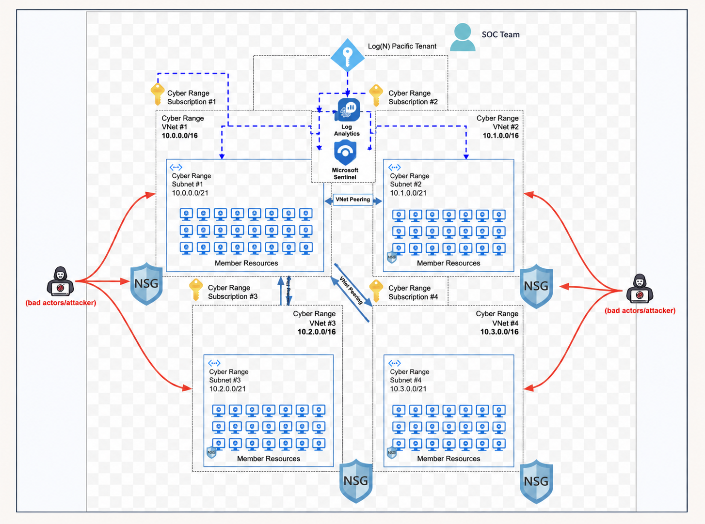
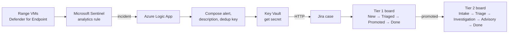
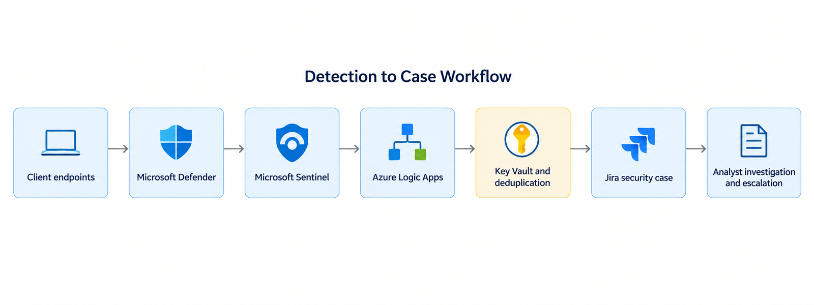
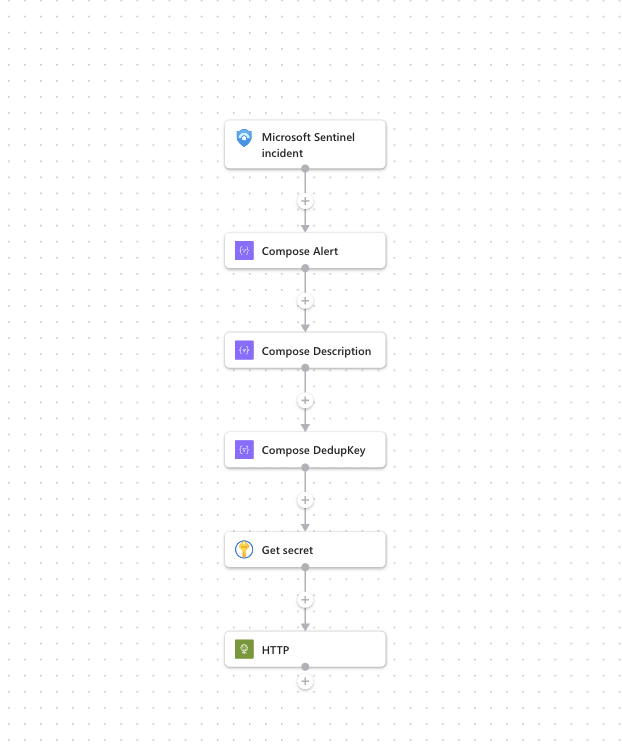
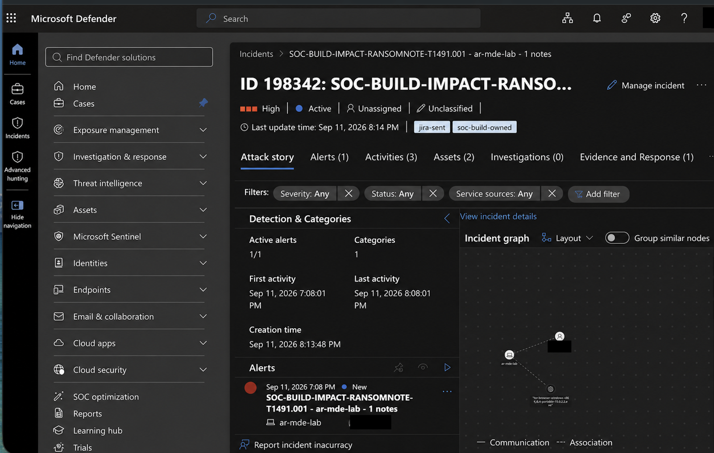
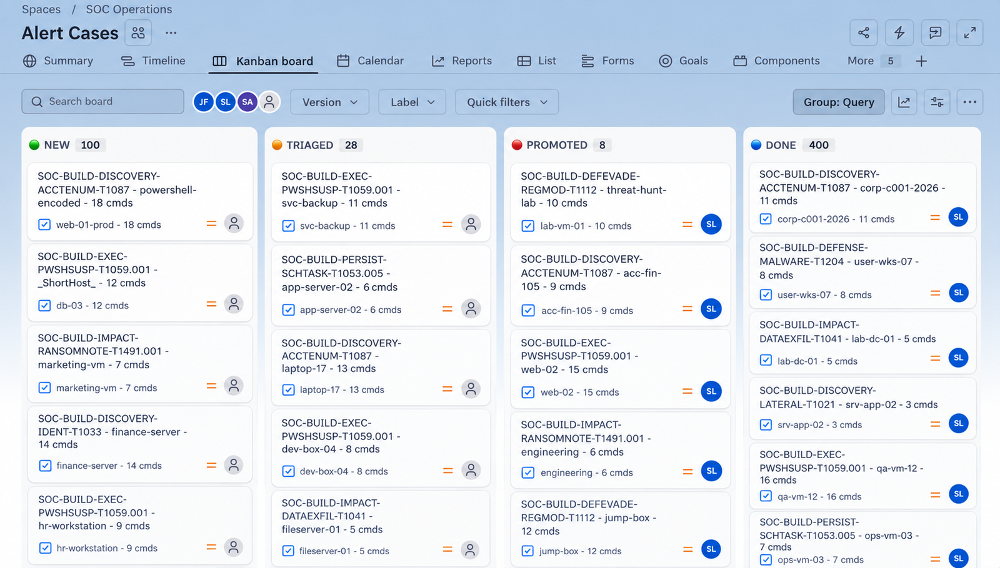
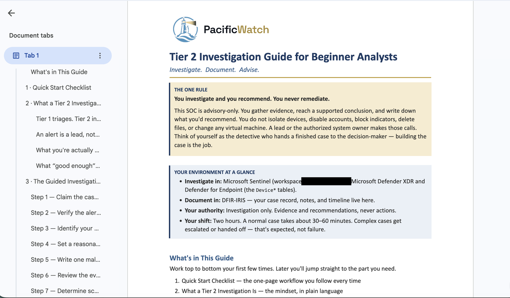

# Pacific Watch Security Operations Center

***Investigate. Document. Advise.***

## What this project demonstrates

Pacific Watch is an advisory-only Security Operations Center (SOC) built on the Log(N) Pacific Cyber Range, a live, intentionally vulnerable Azure training environment.

Our analysts investigate attacker activity, document findings, develop detections, and provide actionable recommendations without performing remediation.

This project demonstrates how a functioning SOC operates: from detection engineering and automated incident creation to analyst triage, escalation, investigation, and cross-shift continuity.

## My role and contributions

**Jenna Frank | Security Operations Manager**

I lead the operational development of Pacific Watch alongside a multidisciplinary leadership team, coordinating the people, processes, and technology required to operate a SOC.

My direct contributions include:

- **Security Automation:** Designed and built the Microsoft Sentinel → Azure Logic Apps → Jira case-management integration, including API connections and Azure Key Vault credential handling.

- **SOC Architecture & Operations:** Designed the Jira case workflow, escalation procedures, analyst progression standards, shift handoffs, and operational processes.

- **Detection Engineering:** Contributed to detection development, analyst playbooks, and standards governing when detection rules are promoted into active SOC queues.

- **Program Leadership:** Coordinated approximately 50 volunteers and 15 leaders across six teams responsible for security operations, detection engineering, threat intelligence, infrastructure, and documentation.

- **Operational Improvements:** Led the response to a 316-case queue flood, introducing stronger detection promotion requirements to reduce unnecessary analyst workload.

## Explore the project

| Area | What You'll Find |
|---|---|
| **Architecture** | How security telemetry becomes an alert, investigation, and tracked case |
| **Security Automation** | Microsoft Sentinel, Azure Logic Apps, API integrations, and case-management workflows |
| **Detection Engineering** | KQL detections, MITRE ATT&CK mapping, and rule-quality standards |
| **SOC Operations** | Analyst workflows, escalation procedures, shift handoffs, and case continuity |
| **Case Studies** | Real operational challenges, investigations, lessons learned, and process improvements |
| **Project Walkthrough** | A video demonstration of the architecture, automation, and case-management workflows |

## Current Project Status | October 2026

Pacific Watch completed approximately one month of live analyst shifts. Operations are currently paused while the leadership team reviews lessons learned and improves the SOC's workflows, detection quality, and case-management processes.

The team is also transitioning case management from Jira to DFIR-IRIS.

The SOC remains an advisory-only training environment. Analysts investigate and recommend; authorized system owners retain responsibility for remediation.

---


## Operational highlights

| | |
|---|---|
| **Range in scope** | Up to 1,500 virtual machines |
| **Team** | About 50 builders and 15 leaders across six teams |
| **Queue flood (July)** | One unthresholded test rule, 1 host. Alerts: 210 to 292 per day, Jul 8 to 15, 2026 (2,210 in total through Jul 16). Jira cases: 316 total. |
| **Under the card** | 17 alerts across 6 rules, 2026-09-25 to 09-26 UTC (09-26 partial): 1 to 9 alerts per rule per day. Not a controlled comparison with July. |
| **Authority** | Advisory only: investigate and recommend, never remediate |

---

## Architecture

The range uses a hub-and-spoke design. The hub subscription holds the shared Log Analytics workspace, Defender for Cloud, and Tenable scanning; each spoke subscription forwards its logs back to the hub.


<sub>Diagram: Log(N) Pacific Cyber Range.</sub>

Each spoke is its own VNet of member VMs behind an NSG. The VMs are exposed to the internet on purpose, and all of them report into Log Analytics and Microsoft Sentinel.


<sub>Diagram: Log(N) Pacific Cyber Range.</sub>

### Detection to case pipeline



---

## Alert → Investigation → Case → Handoff

**1. A detection fires.** Every detection follows one path from endpoint telemetry to an analyst's queue.


<sub>The path every case takes, from endpoint to analyst. The dedup step is the dedup key the Logic App composes; duplicate suppression is a promotion requirement, not a built Logic App feature.</sub>

**2. The pipeline builds the case.** The Logic App composes the case, including a dedup key, and pulls its credential from Key Vault. Every rule must carry a dedup key before promotion to SOC-BUILD.


<br><sub>The Logic App playbook, from Sentinel trigger to Jira request.</sub>

**3. The incident is raised.** A SOC-built detection opens a High severity incident in Defender, tagged once its case is filed.


<sub>A SOC-built ransom note detection (T1491.001) with its case filed. User details redacted.</sub>

**4. The case enters the Tier 1 queue.** Alert Cases land on the Tier 1 board in New. Tier 1 triages each one, and cases that need deeper work are promoted to Tier 2, whose board runs Intake, Triage, Investigation, Advisory, and Done.


<sub>The Tier 1 Alert Cases board: New, Triaged, Promoted, Done. One title still shows an unfilled field (`_ShortHost_`); I traced that to the Logic App and detections not passing host and count values, and fixed both.</sub>

**5. An analyst investigates.** Tier 2 analysts follow a guided investigation that ends in a recommendation, not an action.


<sub>The Tier 2 playbook states the SOC's boundary. Workspace name redacted.</sub>

**6. The case is handed off.** If the case is still open at shift change, it moves to the next shift through a written handoff (see [Cross-shift case continuity](#cross-shift-case-continuity)).

---

## Selected case studies

- [01: The 316-case queue flood](docs/case-studies/01-queue-flood-316-cases.md). One unthresholded test rule produced hundreds of alerts a day and 316 Jira cases; it was paused, and the fix became the build standard.
- [02: Suspicious enumeration that was an exercise](docs/case-studies/02-suspicious-enumeration-exercise.md). Scripted domain enumeration first looked like a participant's account; it was a staged scenario persona, confirmed with the scenario owner and dispositioned as Authorized Simulated Activity.

---

## Cross-shift case continuity

The SOC runs four shifts: Alpha, Bravo, Charlie, and Delta. An investigation that starts on one shift often finishes on another, so every open case is handed off in writing before the shift ends. The next analyst should be able to continue the investigation without rebuilding it.

Every handoff preserves:

- Case status
- Investigation summary
- Evidence reviewed
- Actions taken
- Open questions
- Escalations
- Current owner
- Next action

The full process, including the ticket format and quality standards, is in [docs/shift-handoff-process.md](docs/shift-handoff-process.md).

---

## Escalation

Knowing when to escalate, to whom, and with what context is part of the job. The [escalation matrix](docs/escalation-matrix.md) lists common situations, what a Tier 1 analyst does, who the case goes to, and the context they need to act on it. The permissions behind it are in [docs/rules-of-engagement.md](docs/rules-of-engagement.md).

---

## Detection engineering

The full standard, templates, and a self-audited worked example live in **[pacific-watch-detection-engineering](https://github.com/jennafrank/pacific-watch-detection-engineering)**.

- **SOC-TEST → SOC-BUILD promotion.** New rules start as SOC-TEST and are promoted to SOC-BUILD only once they have a measured threshold and a dedup key, so no unthresholded rule reaches the queue.
- **Detection Build Cards.** Each rule has a card that explains it in plain English: the attacker goal, where it looks, how often it runs, what trips it, what is excluded, and what the detection can and cannot see.
- **ATT&CK mapping.** Rule names carry their tactic, behavior, and technique ID, for example `SOC-BUILD-PERSIST-RUNKEY-T1547.001`, so an analyst knows what the rule claims before opening the case. Two current rules do not yet follow the pattern; that is recorded as an open finding in the detection engineering repo.

---

## Documentation standards

> **If there is no ticket, it did not happen.**

Good case notes let the next analyst, shift, or team continue an investigation without rebuilding it from scratch.

---

## What building this taught me

- **A detection is only useful once someone can investigate and act on it.** A rule that fires into a queue nobody can work is noise with a timestamp.
- **The same behavior can be malicious, administrative, simulated, or expected.** The disposition comes from context, not from the alert name.
- **Noise is operational risk.** One unthresholded test rule produced hundreds of alerts a day and 316 Jira cases, burying real work until it was paused.
- **Documentation is part of incident response.** If the next shift has to rediscover what you found, the investigation has stalled.
- **Escalation is a skill.** It means knowing who needs the case and what context they need to act on it.

---

## Technology stack


Cases are raised in Microsoft Defender and tracked in Jira. Case management is moving to DFIR-IRIS.

---
## Project Walkthrough

A 12-minute walkthrough of the Pacific Watch SOC build, recorded before analyst shifts began. It covers the architecture, the detection pipeline, and how alerts move from Sentinel into Jira.

[](https://youtu.be/4cYRootWJqc)

[Watch on YouTube](https://youtu.be/4cYRootWJqc)
## Project structure

```
cyber-range-soc/
├── README.md
├── CONTRIBUTING.md                    Joining the team and picking up work
└── docs/
    ├── case-studies/                  Selected investigations
    ├── images/                        Diagrams and redacted screenshots
    ├── legacy/                        Superseded files from the GitHub issues era
    ├── escalation-matrix.md           Who gets a case, and what they need
    ├── onboarding.md                  Full onboarding guide
    ├── rules-of-engagement.md         What analysts may and may not do
    └── shift-handoff-process.md       Cross-shift handoff standard
```

---

## Contributing

## Contributors

### Leadership

| Name | Role | Teams | Phases |
|------|------|-------|--------|
| **Jenna Frank** | SOC Program Manager,  SOC Architect | All Teams | All Phases |
| **Reginald Deroslard** | SOC Architect | Architecture | All Phases |

### Security Operations Leads

| Name | Teams | Phases |
|------|-------|--------|
| Jawad Charafeddine | Threat Intelligence | All Phases |
| Derek Heinish | Process & Documentation | All Phases |
| Daniel Torres | Detection Engineering | All Phases |
| Elizabeth Harnisch | Triage & Incident Response | All Phases |
| Pedro Parreira | Infrastructure & Tooling | All Phases |
| Andrea Allen | Cross-Team Communication | All Phases |
| Danielle Respes | Process & Documentation | All Phases |
| Katie Plaster | Tooling | Phase 1 |
| Brad Hahn | Red Team | All Phases |

### Core Builders

| Name | Teams |
|------|-------|
| Ousmane Traore | Detection Engineering · Triage & Incident Response |
| Adetola Kolawole | Process & Documentation |
| Chris Mondejar | Infrastructure & Tooling |
| Jeremy S | Process & Documentation · Threat Intelligence |
| Kemar Morrison | Process & Documentation |
| Rich V | Threat Intelligence |
| Samone Jones | Triage & Incident Response |
| Te'Shawn Young | Detection Engineering · Triage & Incident Response |
| Carlos McGrew | Threat Intelligence |
| Shegufa Haque | Detection Engineering · Triage & Incident Response |
| Vineet Kaur | Infrastructure & Tooling |
| Joshua Fischer | Threat Intelligence |

### Contributors

| Name | Teams |
|------|-------|
| Jide Oyebanji | Infrastructure & Tooling · Triage & Incident Response |
| Jamario Ganaway | Triage & Incident Response |
| El Roi Pablo | Detection Engineering |
| Khadija Abubakar | Infrastructure & Tooling · Process & Documentation |
| Aboubacar Sakho | Detection Engineering |
| James Pabon | Threat Intelligence |
| Jhorman Fuentes | Infrastructure & Tooling |
| Kaddy Gassama | Triage & Incident Response |
| Kerestel Leonard | Detection Engineering |
| Latasha Seth | Threat Intelligence |
| Morris Benton | Detection Engineering |
| Mosharrafa Ahmad | Threat Intelligence |
| Sanskar Malavade | Infrastructure & Tooling |
| Yetunde Odunlami | Process & Documentation |
| Will Butler | Detection Engineering |
| Bard Foster | Detection Engineering |
| Jordan Bowser | Infrastructure & Tooling |
| Karoly Mathe | Threat Intelligence |
| Ricardo Moreno | Threat Intelligence |
| Talamas A | Triage & Incident Response |
| Vasanth Cn | Threat Intelligence |

New analysts start with [CONTRIBUTING.md](CONTRIBUTING.md): how to get access, pick a team, and pick up your first Jira ticket. Questions go to your Shift Lead.
